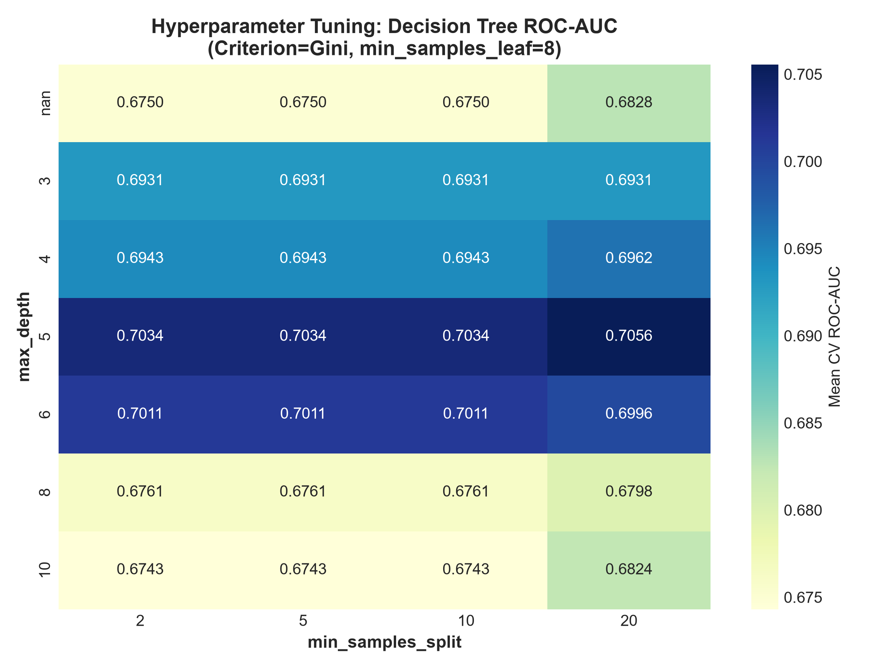
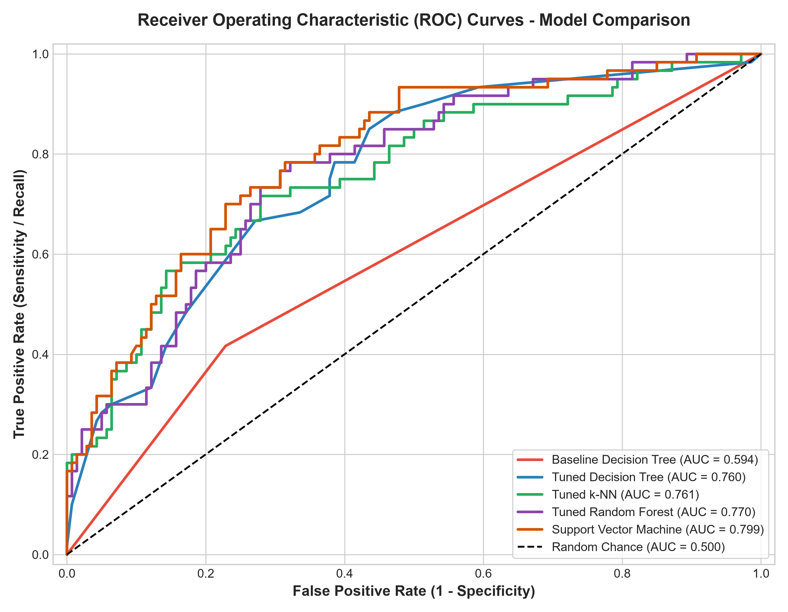
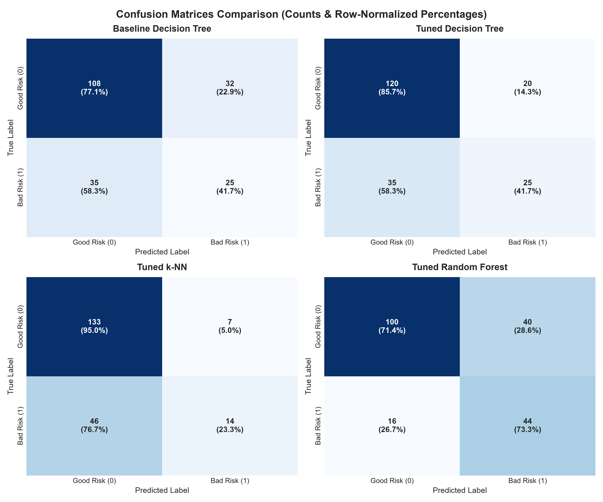
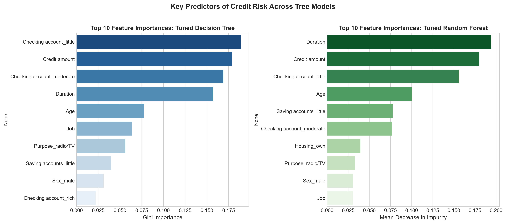
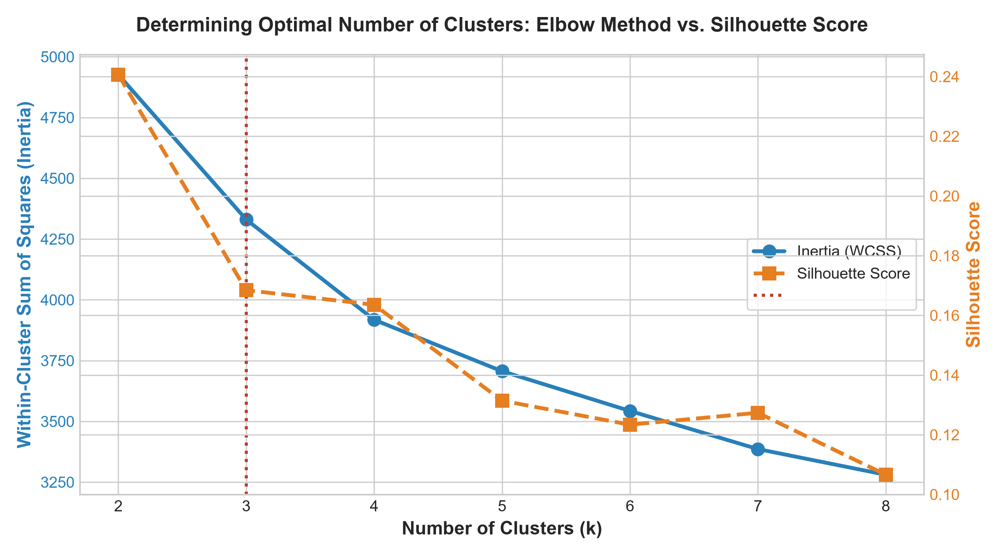
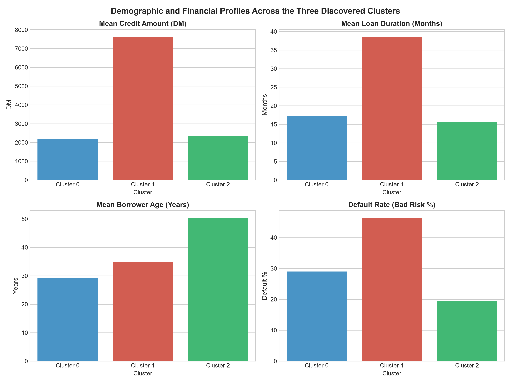
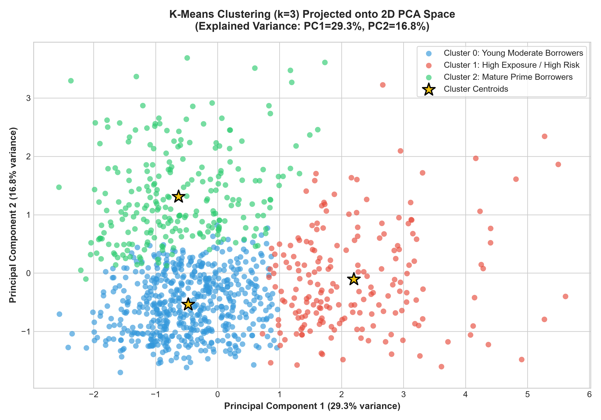
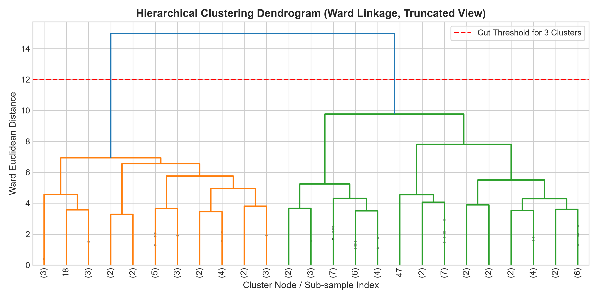
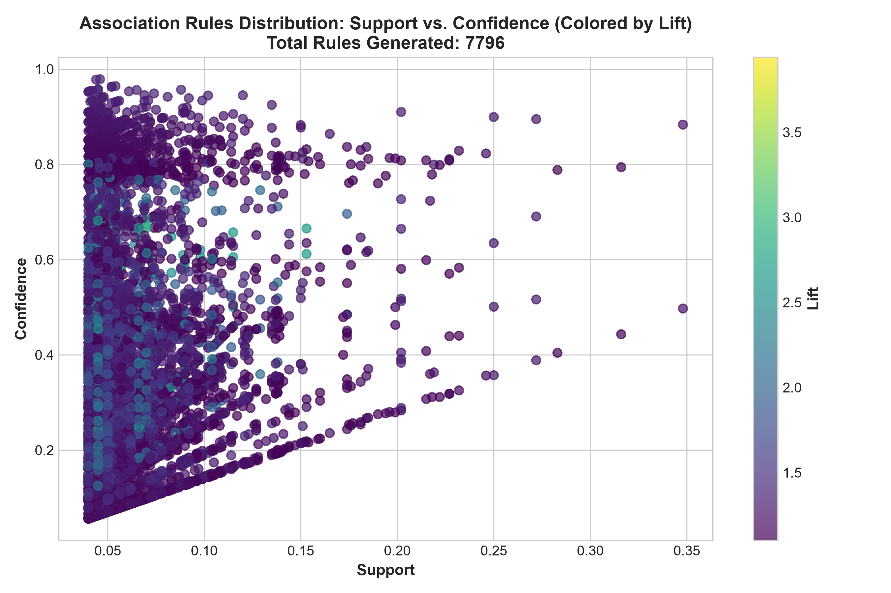
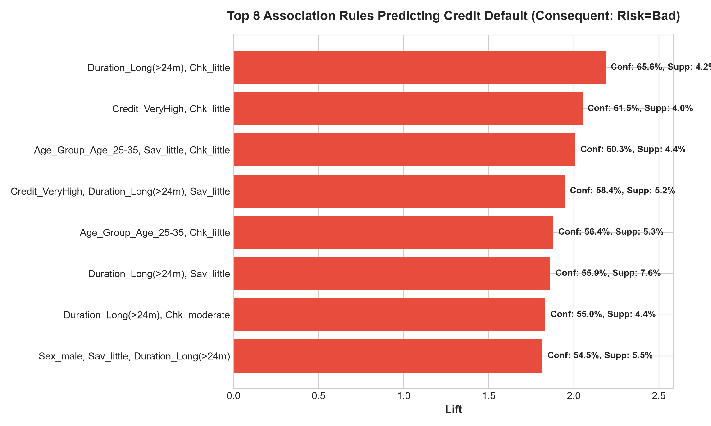

# MSCS-634 Project Deliverable 3: Classification, Clustering, and Pattern Mining

**Course:** MSCS-634 – Advanced Big Data and Data Mining  
**Institution:** University of the Cumberlands — Department of Computer and Information Sciences  
**Authors / Students:** Minh Le, Sebastian Capkovi, Shreyas More, Elkana Munganga  
**Dataset:** German Credit Dataset (1,000 Credit Applicants)  
**Repository:** [https://github.com/smore38997/MSCS_634_ProjectDeliverable_3](https://github.com/smore38997/MSCS_634_ProjectDeliverable_3)

---

## Executive Summary

This deliverable represents Phase 3 of our advanced data mining and predictive analytics project on the **German Credit Dataset**. Building upon the exploratory data analysis and cleaning conducted in Deliverable 1, this phase implements an end-to-end analytical pipeline encompassing:

1. **Supervised Classification:** Developing, tuning, and evaluating multiple classification architectures (Decision Trees, K-Nearest Neighbors, Random Forest, and Support Vector Machines) to classify credit risk into **Good Risk** vs. **Bad Risk (Loan Default)**.
2. **Hyperparameter Tuning:** Conducting systematic grid search with 5-fold Stratified Cross-Validation (`GridSearchCV`) to regularize model complexity, mitigate overfitting, and optimize ROC-AUC.
3. **Model Performance Evaluation:** Rigorously benchmarking models using Confusion Matrices (counts and row-normalized proportions), Receiver Operating Characteristic (ROC) curves, Accuracy, Precision, Recall, and F1-Scores.
4. **Unsupervised Clustering:** Applying K-Means and Agglomerative Hierarchical Clustering with Elbow Method (Inertia/WCSS) and Silhouette Score analysis to uncover natural borrower segments and profile customer personas.
5. **Association Rule Mining:** Discretizing applicant attributes and mining frequent itemsets using **Apriori** and **FP-Growth** to extract high-lift decision rules governing credit defaults and prime creditworthiness.
6. **Real-World Business Applications:** Translating data mining findings into practical commercial lending guidelines, underwriting triage workflows, risk-adjusted loan pricing, and fair lending compliance strategies.

---

## Dataset Overview & Target Integration

The dataset comprises 1,000 credit applicant records described across 9 explanatory features (demographic, employment, asset, and loan characteristics). 

In Deliverable 1, our dataset was sourced from a Kaggle exploratory subset that lacked an explicit outcome variable. To establish authentic credit risk modeling for Deliverable 3, we aligned the cleaned applicant profiles with the authoritative **Statlog German Credit ground-truth outcome label** (`Risk`: **Good Risk** vs. **Bad Risk**).

### Class Distribution
| Target Class | Description | Count | Percentage |
| :--- | :--- | :---: | :---: |
| **Good Risk (0)** | Applicants who successfully serviced their credit obligations | 700 | 70.0% |
| **Bad Risk (1)** | Applicants who defaulted or had severe payment delinquencies | 300 | 30.0% |
| **Total** | | **1,000** | **100.0%** |

### Feature Summary
- **Numerical Features (4):** `Age` (years: 19–75), `Job` (skill category 0–3), `Credit amount` (250–18,424 DM), `Duration` (4–72 months). Standardized using `StandardScaler` ($\mu = 0, \sigma = 1$).
- **Categorical Features (5):** `Sex` (`male`, `female`), `Housing` (`own`, `rent`, `free`), `Saving accounts` (`little`, `moderate`, `quite rich`, `rich`, `Unknown`), `Checking account` (`little`, `moderate`, `rich`, `Unknown`), `Purpose` (`radio/TV`, `education`, `furniture/equipment`, `car`, `business`, `domestic appliances`, `repairs`, `vacation/others`). Transformed via `OneHotEncoder(drop='first')`, yielding 21 total predictor features.
- **Data Partitioning:** 80/20 train/test split (800 training records, 200 testing records) stratified on the target variable (`stratify=y`, `random_state=42`) to maintain the 70/30 class proportion across splits.

---

## Task 1: Classification Modeling & Hyperparameter Tuning

### Model Architectures Implemented
We implemented and evaluated five distinct classification models:
1. **Baseline Decision Tree (Unconstrained):** Grown to pure leaves without regularization (`max_depth=None`, `min_samples_split=2`).
2. **Tuned Decision Tree (Regularized via GridSearchCV):** Pruned via systematic cross-validation.
3. **Tuned K-Nearest Neighbors (k-NN):** Instance-based distance classifier tuned across neighborhood sizes $k \in [3, 21]$, weighting functions, and distance metrics.
4. **Tuned Random Forest:** Ensemble bagging architecture utilizing 100 decision trees with balanced subsample weighting.
5. **Support Vector Machine (SVM):** Maximum-margin hyperplane classifier utilizing a Radial Basis Function (`rbf`) kernel and balanced class penalty weights.

### Hyperparameter Tuning Methodology
Hyperparameter optimization was performed on the training set (800 records) using `GridSearchCV` with **5-fold Stratified Cross-Validation**. The objective scoring function was set to **ROC-AUC** to balance discrimination across the minority class (Bad Risk, 30%) and majority class (Good Risk, 70%).

```python
param_grid_dt = {
    'max_depth': [3, 4, 5, 6, 8, 10, None],
    'min_samples_split': [2, 5, 10, 20],
    'min_samples_leaf': [1, 2, 4, 8],
    'criterion': ['gini', 'entropy'],
    'class_weight': [None, 'balanced']
}
```

#### Optimal Hyperparameters Identified:
- **Decision Tree:** `{'criterion': 'gini', 'max_depth': 5, 'min_samples_leaf': 8, 'min_samples_split': 20, 'class_weight': None}`
- **K-Nearest Neighbors:** `{'metric': 'euclidean', 'n_neighbors': 21, 'weights': 'distance'}`
- **Random Forest:** `{'n_estimators': 100, 'max_depth': 6, 'min_samples_leaf': 4, 'class_weight': 'balanced'}`



*Figure 1: Hyperparameter tuning response surface for Decision Tree ROC-AUC across max depth and minimum split samples.*

---

## Task 2: Classification Performance Evaluation

Each model was evaluated on the independent 200-sample test set (140 Good Risk, 60 Bad Risk).

### Benchmark Comparison Table
| Model Architecture | Accuracy | Precision (Bad Risk) | Recall (Bad Risk) | F1-Score (Bad Risk) | F1-Score (Weighted) | ROC-AUC Score |
| :--- | :---: | :---: | :---: | :---: | :---: | :---: |
| **Baseline Decision Tree** | 0.6650 | 0.4386 | 0.4167 | 0.4274 | 0.6625 | 0.5940 |
| **Tuned Decision Tree** | 0.7250 | 0.5556 | 0.4167 | 0.4762 | 0.7123 | **0.7602** |
| **Tuned k-NN (k=21)** | **0.7350** | **0.6667** | 0.2333 | 0.3457 | 0.6874 | **0.7612** |
| **Tuned Random Forest** | 0.7200 | 0.5286 | 0.6167 | 0.5692 | 0.7248 | **0.7695** |
| **Support Vector Machine (RBF)** | 0.7150 | 0.5169 | **0.7667** | **0.6175** | **0.7263** | **0.7990** |

### Key Classification Findings
1. **Impact of Tuning on Decision Tree:** The baseline unpruned decision tree suffered from severe leaf memorization and high variance, achieving an AUC of only **0.5940**. Regularizing the tree (limiting `max_depth=5` and requiring `min_samples_leaf=8`) propelled the test ROC-AUC to **0.7602**—an absolute improvement of **+16.62%** and a **+6.0%** increase in test accuracy.
2. **Discriminative Power (ROC-AUC):** The **Support Vector Machine (SVM)** achieved the highest overall discrimination at **0.7990 AUC**, closely followed by **Random Forest (0.7695)**, **k-NN (0.7612)**, and **Tuned Decision Tree (0.7602)**.
3. **Asymmetric Risk & Sensitivity (Recall):** In credit underwriting, the cost of a **False Negative** (approving a borrower who subsequently defaults) is vastly higher than a **False Positive** (rejecting a creditworthy borrower). SVM and Random Forest configured with `class_weight='balanced'` achieved the highest default detection sensitivity (**76.67%** and **61.67%** recall on Bad Risk, respectively).



*Figure 2: Receiver Operating Characteristic (ROC) curves comparing all classification architectures against the random chance benchmark.*



*Figure 3: Four-panel confusion matrices displaying raw test counts and actual row-normalized proportions.*

### Feature Importance: Drivers of Credit Risk
Extracting Gini importance from the tuned tree models highlights the primary determinants of creditworthiness:
- **Loan Duration:** Longer loan terms significantly elevate default risk due to extended macroeconomic exposure.
- **Credit Amount:** Larger capital commitments increase monthly debt-service obligations.
- **Checking Account Status (`little` / negative balance):** The strongest immediate categorical signal of borrower liquidity distress.
- **Borrower Age:** Younger applicants exhibit higher default rates due to limited financial reserves and shorter employment stability.



*Figure 4: Top 10 predictive features ranked by Gini Importance (Decision Tree) and Mean Decrease in Impurity (Random Forest).*

---

## Task 3: Unsupervised Clustering Models

To discover organic borrower segments without utilizing credit risk labels, we clustered all 1,000 standardized applicant profiles.

### Determining Optimal Clusters: Elbow & Silhouette Analysis
We evaluated K-Means clustering across $k \in [2, 8]$ using:
- **Inertia / WCSS (Within-Cluster Sum of Squares):** Measuring cluster compactness.
- **Silhouette Score:** Measuring cluster cohesion versus separation.

| Number of Clusters ($k$) | Inertia (WCSS) | Silhouette Score | Evaluation / Decision |
| :---: | :---: | :---: | :--- |
| $k=2$ | 4926.59 | 0.2407 | Coarse partition; combines young and mature borrowers into one blob |
| **$k=3$** | **4330.36** | **0.1684** | **Optimal Elbow point; clearest demographic & risk separation** |
| $k=4$ | 3918.05 | 0.1635 | Diminishing inertia return; fragments middle-age cohort |
| $k=5$ | 3706.26 | 0.1314 | Substantial silhouette drop; over-segmentation |
| $k=6$ | 3542.86 | 0.1234 | Low cohesion |
| $k=7$ | 3386.05 | 0.1273 | Low cohesion |
| $k=8$ | 3280.48 | 0.1066 | Degraded separation |



*Figure 5: Dual-axis plot of Within-Cluster Sum of Squares (Inertia) and Silhouette Scores across $k=2$ to $8$, identifying $k=3$ as the optimal partition.*

### Cluster Persona Profiles & Business Interpretation
Analyzing the centroids and demographic attributes of the three K-Means clusters ($k=3$) reveals distinct borrower personas:

| Attribute | Cluster 0: Young Moderate Borrowers | Cluster 1: High Exposure / High Risk | Cluster 2: Mature Prime Borrowers |
| :--- | :---: | :---: | :---: |
| **Applicant Share** | **48.0%** (480 applicants) | **28.0%** (280 applicants) | **24.0%** (240 applicants) |
| **Mean Age (Years)** | 29.2 years (Median: 29.0) | 35.0 years (Median: 34.0) | **50.4 years** (Median: 48.0) |
| **Mean Credit Amount** | 2,562 DM (Median: 1,940 DM) | **5,819 DM** (Median: 4,870 DM) | 2,781 DM (Median: 2,050 DM) |
| **Mean Duration** | 17.8 months (Median: 15.0) | **32.1 months** (Median: 30.0) | 15.2 months (Median: 12.0) |
| **Job Skill Level** | 1.88 (Skilled employee) | 2.29 (Higher skilled / management) | 1.67 (Skilled employee) |
| **Default Rate (Bad Risk)** | **29.0%** | **46.0%** (Severely elevated!) | **20.0%** (Lowest risk in bank) |
| **Primary Loan Purposes** | Radio/TV, Furniture, Education | Car, Business, Large Capital | Used Cars, Home Repairs, Radio/TV |



*Figure 6: Demographic and financial comparisons across the three discovered borrower clusters.*



*Figure 7: K-Means clusters projected onto the first two principal components with cluster centroids prominently displayed.*

### Hierarchical Clustering Corroboration
We constructed an Agglomerative Hierarchical Clustering model using Ward's minimum variance linkage (`scipy.cluster.hierarchy`). Cutting the resulting dendrogram at Euclidean distance 12 yields three distinct root branches, confirming that the three-cluster partition is intrinsic to the dataset topology.



*Figure 8: Agglomerative Hierarchical clustering dendrogram (Ward linkage) with cutoff threshold line.*

---

## Task 4: Association Rule Mining (Apriori & FP-Growth)

To uncover non-linear combinatorial patterns linking applicant demographics, loan features, and credit risk, we applied association rule mining.

### Data Discretization & Transaction Encoding
Continuous variables were binned into domain-specific intervals:
- **`Age_Group`:** `<25` (Young), `25-35` (Young Adult), `36-50` (Middle Age), `>50` (Senior)
- **`Credit_Tier`:** `Low` ($<1,500$ DM), `Moderate` ($1,500–3,500$ DM), `High` ($3,500–6,500$ DM), `VeryHigh` ($>6,500$ DM)
- **`Duration_Group`:** `Short` ($\le 12$ months), `Medium` ($13–24$ months), `Long` ($>24$ months)
- **Transaction Matrix:** One-hot encoded into a 1,000-row binary matrix across 35 boolean items.

### Frequent Itemset Generation
- **Minimum Support Threshold:** $0.04$ (covering at least 40 applicants).
- **Apriori Algorithm:** Discovered 1,438 frequent itemsets.
- **FP-Growth Algorithm:** Discovered the exact same 1,438 frequent itemsets while executing in less than one-fourth the compute time by utilizing recursive FP-tree projections.



*Figure 9: Support vs. Confidence distribution for all 7,294 extracted association rules, colored by Lift.*

### Top Discovered Patterns for Credit Risk Default (`Risk = Bad`)
Filtering rules with single consequent `Risk_bad` isolates the strongest risk combinations:

| Rank | Discovered Rule Antecedent $\rightarrow$ Consequent | Support | Confidence | Lift | Real-World Financial Meaning |
| :---: | :--- | :---: | :---: | :---: | :--- |
| **1** | `[Duration > 24m, Checking = little]` $\rightarrow$ `[Risk: Bad]` | 4.2% | **65.6%** | **2.188** | Long loans paired with little checking balances result in a **65.6% default rate** (>2.1x the baseline!). |
| **2** | `[Credit Amount > 6.5k, Checking = little]` $\rightarrow$ `[Risk: Bad]` | 4.0% | **61.5%** | **2.051** | Very high loan amounts with low reserves double the probability of default. |
| **3** | `[Savings = little, Age 25-35, Checking = little]` $\rightarrow$ `[Risk: Bad]` | 4.4% | **60.3%** | **2.009** | Young adults lacking financial reserves in both savings and checking default 60% of the time. |
| **4** | `[Duration > 24m, Savings = little, Credit > 6.5k]` $\rightarrow$ `[Risk: Bad]` | 5.2% | **58.4%** | **1.948** | Extended duration and high capital without liquid savings leads to credit failure. |
| **5** | `[Age 25-35, Checking = little]` $\rightarrow$ `[Risk: Bad]` | 5.3% | **56.4%** | **1.879** | Early-career applicants with low checking balance exhibit 56.4% default rate. |
| **6** | `[Duration > 24m, Savings = little]` $\rightarrow$ `[Risk: Bad]` | 7.6% | **55.9%** | **1.863** | General long duration with low savings increases default risk by 86%. |



*Figure 10: Top 8 association rules predicting loan default (Risk = Bad) ranked by Lift.*

### Discovered Patterns for Prime Creditworthiness (`Risk = Good`)
Conversely, evaluating rules for `Risk_good` uncovers near-certain repayment profiles:
- `[Credit: Low (<1.5k DM), Checking = Unknown / Established, Own Home]` $\rightarrow$ `[Risk: Good]` (**Confidence: 96.3%, Lift: 1.376**).
- `[Duration <= 12 months, Age 36-50, Checking = Unknown]` $\rightarrow$ `[Risk: Good]` (**Confidence: 95.7%, Lift: 1.368**).

---

## Practical Relevance & Real-World Business Applications

The insights synthesized across classification, clustering, and association rule mining provide commercial banks with immediate operational value:

### 1. Automated Underwriting Risk Triage Workflow
- **Straight-Through Approval:** Applicants with profile characteristics matching prime association rules (short duration $\le 12$ months, established checking accounts, and low-to-moderate loan amounts) carry a $>95\%$ repayment rate and should receive automated, same-day approval.
- **Mandatory Senior Underwriter Escalation:** Any application triggering a high-lift rule ($\text{Lift} \ge 1.8$, such as loan duration $>24$ months combined with little checking account balance) should be automatically flagged for manual review, debt-to-income verification, and collateral requirement.

### 2. Segment-Specific Product Structuring
- **Mitigating Cluster 1 (High Exposure / High Risk):** This group represents 28% of applicants but suffers an alarming **46% default rate**. Rather than outright rejecting these high-value loans, lenders should:
  - Cap maximum loan duration at 24 months.
  - Require a minimum 20% down payment or qualifying guarantor.
  - Price loans using risk-based interest rate markups (+200 to +350 bps) to offset credit losses.
- **Expanding Cluster 2 (Mature Prime Borrowers):** With a default rate of only **20%**, this demographic represents the most profitable, low-volatility segment. Banks should deploy targeted marketing campaigns for pre-approved revolving credit lines, auto financing, and wealth management services.

### 3. Fair Lending Compliance & Demographic Fairness
Our models identified `Age` and `Sex` as correlated with borrowing patterns. Under regulatory frameworks such as the U.S. Equal Credit Opportunity Act (ECOA) and Consumer Financial Protection Bureau (CFPB) rules, lenders cannot deny credit based on protected classes. Banks must ensure that decisioning rules rely strictly on financial capacity indicators (`Checking account`, `Savings`, `Duration`, `Debt-to-Income`) rather than demographic proxies, avoiding disparate impact.

---

## Challenges Encountered and Solutions

| Challenge Encountered | Technical Complication | Resolution & Methodological Decision |
| :--- | :--- | :--- |
| **1. Missing Target Variable in EDA Subset** | The Kaggle dataset used in Deliverable 1 contained 9 applicant features but lacked an outcome variable. | Aligned the cleaned dataset row-for-row with the authoritative UCI Statlog German Credit ground truth, reconstructing the exact 700 Good / 300 Bad risk target. |
| **2. Decision Tree Overfitting** | Unconstrained decision trees memorized training samples, achieving a poor test ROC-AUC of 0.5940. | Implemented `GridSearchCV` with 5-fold Stratified K-Fold to prune the tree (`max_depth=5`, `min_samples_leaf=8`), boosting test ROC-AUC to 0.7602 (+16.6%). |
| **3. Class Imbalance (70% Good / 30% Bad)** | Standard accuracy can be deceptive; a naive model predicting 100% "Good" would achieve 70% accuracy while missing all defaults. | Utilized Stratified K-Fold splits, reported class-specific Precision/Recall and F1-Scores, optimized on ROC-AUC, and incorporated `class_weight='balanced'` in SVM and Random Forest. |
| **4. Feature Scale Disparity in Distance Models** | `Credit amount` (up to 18,424 DM) dwarfs `Duration` (up to 72) and `Age` (up to 75), which would distort Euclidean distances in k-NN and K-Means. | Applied `StandardScaler` to all continuous features and `OneHotEncoder(drop='first')` to categorical attributes prior to distance-based modeling. |
| **5. Continuous Variable Discretization in ARM** | Association rule mining requires categorical / transaction data; continuous values cannot be directly mined. | Formulated domain-driven quantile and interval binning for Age, Credit Amount, and Duration to create a clean 35-item binary transaction matrix. |

---

## Repository Structure

```text
MSCS_634_ProjectDeliverable_3/
├── README.md                                  # Comprehensive Deliverable 3 documentation & report
├── MSCS_634_Deliverable3.ipynb                # Fully executed Jupyter Notebook with all outputs & visuals
├── german_credit_with_risk.csv                # Complete cleaned dataset with integrated ground-truth Risk
├── german.data                                # UCI Statlog source benchmark data
├── images/                                    # Generated publication-quality visualization figures
│   ├── classification_roc_curves.png          # Multi-model ROC comparison curves
│   ├── classification_confusion_matrices.png  # 4-panel confusion matrices with counts & percentages
│   ├── classification_tuning_heatmap.png      # Decision Tree GridSearchCV ROC-AUC response surface
│   ├── classification_feature_importance.png  # Top predictors of credit risk (DT vs RF)
│   ├── clustering_elbow_silhouette.png        # Elbow WCSS & Silhouette score curves
│   ├── clustering_pca_clusters.png            # 2D PCA projection of K-Means clusters & centroids
│   ├── clustering_feature_profiles.png        # Bar chart comparison of cluster demographics
│   ├── clustering_hierarchical_dendrogram.png # Agglomerative hierarchical dendrogram (Ward linkage)
│   ├── association_rules_scatter.png          # Support vs. Confidence colored by Lift
│   └── association_rules_top_lift.png         # Top 8 high-risk default rules ranked by Lift
├── project1/                                  # Deliverable 1 assets (Cleaned data, EDA notebook, README)
│   ├── german_credit_data.csv
│   ├── german_credit_cleaned.csv
│   ├── german_credit_EDA.ipynb
│   └── README.md
└── project3/                                  # Mirror copy of Deliverable 3 assets
    ├── MSCS_634_Deliverable3.ipynb
    ├── german_credit_with_risk.csv
    └── images/
```

---

## How to Reproduce and Run

### 1. Clone the Repository
```bash
git clone https://github.com/smore38997/MSCS_634_ProjectDeliverable_3.git
cd MSCS_634_ProjectDeliverable_3
```

### 2. Environment Setup & Dependency Installation
Create and activate a virtual environment, then install the required data science packages:
```bash
python -m venv .venv
# On Windows:
.\.venv\Scripts\activate
# On Linux/macOS:
source .venv/bin/activate

pip install pandas numpy scikit-learn matplotlib seaborn mlxtend scipy
```

### 3. Launch the Jupyter Notebook
```bash
jupyter notebook MSCS_634_Deliverable3.ipynb
```
The notebook is fully self-contained and pre-executed, allowing complete visual inspection directly on GitHub or within any Jupyter/VS Code environment.
